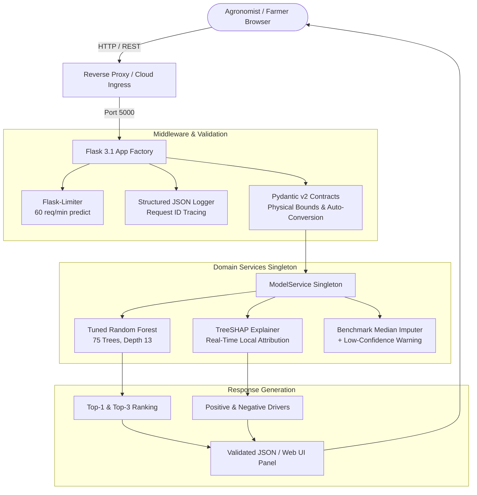
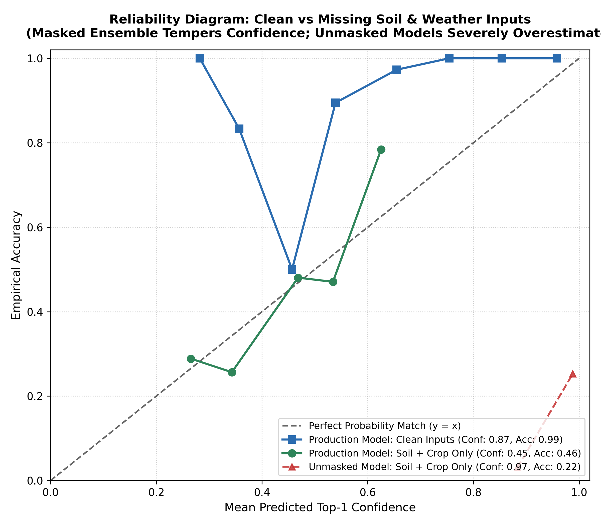

# Fertilizer Recommendation Service: ML + REST API

[](https://github.com/lazycoder52/fertilizer/actions/workflows/ci.yml)
[](https://github.com/astral-sh/ruff)
[](Dockerfile)
[](LICENSE)

A machine learning service and REST API for agronomic fertilizer recommendation, featuring TreeSHAP explainability, Pydantic v2 input contracts, lean multi-stage Docker containerization, and automated CI quality gates.

The service is designed to run locally or containerized via Docker. Interactive OpenAPI / Swagger documentation is available at `http://localhost:5000/apidocs/` when run locally.

---

## 60-Second Summary

- **What the Project Does**:
  - **Inputs**: Categorical soil type and crop category, plus 8 continuous environmental & soil test parameters: Nitrogen ($N$), Phosphorous ($P$), Potassium ($K$), pH, Soil Moisture, Temperature, Rainfall, and Carbon.
  - **Outputs**: Top-1 fertilizer recommendation, Top-3 ranked formulations with predicted class probabilities, agronomic guidance remarks, and real-time local TreeSHAP feature attribution explanations (identifying positive drivers and negative inhibitors).
- **The Approach (in 3 lines)**:
  1. **Tuned Ensemble ML**: A Bayesian-optimized Random Forest classifier trained with 35% random feature masking so the model learns uncertainty when soil test parameters are missing.
  2. **TreeSHAP Explainability**: Pre-computed TreeSHAP background distributions delivering instant local feature attribution to justify each agronomic recommendation.
  3. **Robust REST API & UI**: A clean Flask application with Pydantic v2 validation contracts, dynamic rate limiting, structured JSON logging, and interactive OpenAPI documentation.
- **Key Results** (rendered directly from `model_files/metrics.json` via `render_docs`):
  - **Clean Holdout ($N=620$)**:
    - **Top-1 Accuracy**: **<!-- BEGIN:holdout_top1 -->$98.71\%$<!-- END:holdout_top1 -->**
    - **Top-3 Accuracy**: **<!-- BEGIN:holdout_top3 -->$100.00\%$<!-- END:holdout_top3 -->**
    - **Macro-F1**: **<!-- BEGIN:holdout_macro_f1 -->$0.9431$<!-- END:holdout_macro_f1 -->**
  - **Soil+Crop-Only Holdout ($N=620$, omitted continuous inputs)**:
    - **Top-1 Accuracy**: **<!-- BEGIN:masked_rf_sc_top1 -->$46.29\%$<!-- END:masked_rf_sc_top1 -->**
    - **Top-3 Accuracy**: **<!-- BEGIN:masked_rf_sc_top3 -->$79.84\%$<!-- END:masked_rf_sc_top3 -->**
  - **Masked vs. Unmasked Benchmark Comparison**:
<!-- BEGIN:comparison_table -->
| Model Candidate | 5-Fold CV Top-1 | 5-Fold CV Macro-F1 | Clean Holdout Top-1 | Clean Holdout ECE | Soil+Crop Top-1 | Soil+Crop Top-3 | Soil+Crop ECE | Soil+Crop Mean Conf |
| :--- | :---: | :---: | :---: | :---: | :---: | :---: | :---: | :---: |
| **Zero-Rule Majority Baseline** | $33.99\% \pm 0.10\%$ | $0.0507$ | $34.03\%$ | $0.6597$ | $34.03\%$ | $60.81\%$ | $0.6597$ | $100.00\%$ |
| **Logistic Regression (Standardized)** | $80.36\% \pm 0.91\%$ | $0.6815$ | $79.84\%$ | $0.0759$ | $19.35\%$ | $66.29\%$ | $0.1880$ | $38.15\%$ |
| **Decision Tree (Clean)** | $99.28\% \pm 0.52\%$ | $0.9771$ | $99.19\%$ | $0.0081$ | $21.77\%$ | $29.84\%$ | $0.7823$ | $100.00\%$ |
| **Decision Tree (Mask-Augmented 35%)** | $94.27\% \pm 1.06\%$ | $0.8910$ | $96.77\%$ | $0.0323$ | $48.87\%$ | $82.26\%$ | $0.0623$ | $55.09\%$ |
| **LightGBM (Clean)** | $98.71\% \pm 0.35\%$ | $0.9725$ | $98.71\%$ | $0.0109$ | $21.77\%$ | $66.77\%$ | $0.7823$ | $100.00\%$ |
| **LightGBM (Mask-Augmented 35%)** | $97.79\% \pm 0.58\%$ | $0.9060$ | $97.74\%$ | $0.0082$ | $49.84\%$ | $84.19\%$ | $0.0352$ | $52.96\%$ |
| **Random Forest (Default Clean)** | $99.11\% \pm 0.33\%$ | $0.9683$ | $99.52\%$ | $0.0721$ | $21.77\%$ | $37.74\%$ | $0.7496$ | $96.73\%$ |
| **Random Forest (Tuned Clean, 75 trees)** | $99.23\% \pm 0.20\%$ | $0.9720$ | $99.35\%$ | $0.0733$ | $21.77\%$ | $55.32\%$ | $0.7537$ | $97.15\%$ |
| **Random Forest (Tuned + 35% Masking, Production)** | $98.63\% \pm 0.59\%$ | $0.9475$ | **$98.71\%$** | **$0.1209$** | **$46.29\%$** | **$79.84\%$** | **$0.0593$** | **$44.90\%$** |
<!-- END:comparison_table -->

- **How to Run Locally in 3 Commands**:
  ```bash
  pip install -r requirements.txt
  python app.py
  # Open http://localhost:5000 in your browser (OpenAPI documentation at http://localhost:5000/apidocs/)
  ```

---

## Limitations & Project Scope

1. **Synthetic Benchmark Dataset**: The model was trained and evaluated on a synthetic benchmark dataset (`fertilizer_recommendation_dataset.csv`). As documented in the [Data Audit](docs/DATA_CARD.md), the dataset contains synthetic generation artifacts (negative values in rainfall and phosphorus, 1-to-1 correspondence between the `Remark` column and labels, and axis-aligned rectangular decision boundaries). High model accuracy reflects the algorithm learning these deterministic generating rules rather than natural biological agronomy.
2. **Holdout Sample Size & Statistical Significance**: The holdout evaluation set is 620 samples ($N=620$). At this sample size, accuracy differences of roughly 1 percentage point ($\approx 6$ samples) are within statistical noise and should not be over-interpreted as model superiority.
3. **No Validation on Real Farm Data**: Predictions are advisory decision-support tools and have not been validated on real farm data or in biological field trials. They should not substitute for certified wet-chemistry laboratory soil testing and localized agricultural extension recommendations.
4. **Formulation Only (No Dosage or Schedule)**: The model predicts **which** fertilizer formulation suits the crop and soil nutrient balance (e.g., DAP for phosphorus deficiency, Muriate of Potash for potassium deficit, or Urea for leafy vegetative growth). It does **NOT** calculate quantitative volumetric dosage ($\text{kg/ha}$ or $\text{lbs/acre}$) or seasonal application schedules across crop phenological stages.

---

## Design Decisions

- **Why Masked Training**:
  - In real farming scenarios, continuous soil testing inputs (NPK, pH, Carbon, Moisture) are frequently unavailable or partially tested.
  - When continuous inputs are omitted, standard unmasked models (Decision Trees, LightGBM, Random Forest) collapse to $21.77\%$ Top-1 accuracy while exhibiting severe over-confidence ($96.73\% - 100.00\%$ confidence, $\text{ECE} > 0.74$).
  - Training with 35% random feature masking forces the model to learn marginal distributions and temper its confidence when inputs are missing, achieving **<!-- BEGIN:masked_rf_sc_mean_conf -->$44.90\%$<!-- END:masked_rf_sc_mean_conf -->** mean confidence and an ECE of **<!-- BEGIN:masked_rf_sc_ece -->$0.0593$<!-- END:masked_rf_sc_ece -->** on Soil+Crop-only queries.
- **Why Random Forest was Kept over Masked LightGBM**:
  - Across model evaluations, the performance trade-off between `Random_Forest_Tuned_Masked` and `LightGBM_Masked` is marginal across both complete and missing input regimes:
    - **Clean Holdout ($N=620$)**: Random Forest achieves **<!-- BEGIN:holdout_top1 -->$98.71\%$<!-- END:holdout_top1 -->** Top-1 and **<!-- BEGIN:holdout_top3 -->$100.00\%$<!-- END:holdout_top3 -->** Top-3, compared to LightGBM's **<!-- BEGIN:masked_lgbm_clean_top1 -->$97.74\%$<!-- END:masked_lgbm_clean_top1 -->** Top-1 and **<!-- BEGIN:masked_lgbm_clean_top3 -->$99.35\%$<!-- END:masked_lgbm_clean_top3 -->** Top-3.
    - **Soil+Crop-Only Holdout ($N=620$)**: LightGBM achieves **<!-- BEGIN:masked_lgbm_sc_top1 -->$49.84\%$<!-- END:masked_lgbm_sc_top1 -->** Top-1 and **<!-- BEGIN:masked_lgbm_sc_top3 -->$84.19\%$<!-- END:masked_lgbm_sc_top3 -->** Top-3, compared to Random Forest's **<!-- BEGIN:masked_rf_sc_top1 -->$46.29\%$<!-- END:masked_rf_sc_top1 -->** Top-1 and **<!-- BEGIN:masked_rf_sc_top3 -->$79.84\%$<!-- END:masked_rf_sc_top3 -->** Top-3.
  - With 620 holdout samples, a gap of about 3 points is within noise.
  - The Random Forest artifact is maintained as the baseline pending broader architectural migration review.
- **Future Work**:
  - Validating and fine-tuning on real-world empirical soil testing datasets and multi-region agronomic field trials.
  - Expanding the prediction contract to estimate quantitative volumetric dosage ($\text{kg/ha}$) and growth-stage scheduling.

---

## Architecture Overview

The application is structured into decoupled modules following clean architecture and production ML engineering patterns:



---

## Key Highlights & Engineering Rigor

- **Empirical Data Audit as an ML Signal**:
  - Uncovered raw benchmark flaws: negative physical values (rainfall $-85.71\text{ mm}$, phosphorus $-37.65\text{ kg/ha}$), 1-to-1 deterministic correspondence between `Remark` and target classes, and sharp rectangular boundaries.
  - **Zero Target Leakage Verified**: `Remark` and target are strictly excluded from input vectors (`assert "Remark" not in feature_cols`).
  - Added Pydantic v2 boundary enforcement to reject unphysical inputs at the API gateway.
- **Model Selection & Masked Training Rationale**:
  - Across candidates, high accuracy stems from learning the synthetic rule partitions, while missing-input robustness comes strictly from **feature mask augmentation**, not from model architecture. TreeSHAP attribution is supported across tree models including LightGBM and Decision Trees.
  - When continuous inputs are omitted, unmasked tree models (Decision Tree, LightGBM, Random Forest Default, Random Forest Tuned) collapse to $21.77\%$ Top-1 accuracy with extreme over-confidence (mean confidence $96.73\% - 100.00\%$, ECE $> 0.74$). Across all evaluated unmasked candidates (including Logistic Regression at $19.35\%$ accuracy / $38.15\%$ confidence / ECE $0.1880$, and the Zero-Rule baseline at $34.03\%$ accuracy / $100.00\%$ confidence / ECE $0.6597$), every unmasked model is over-confident (mean confidence > accuracy).
  - When trained with 35% feature masking, models gracefully degrade:
    - **Masked LightGBM** achieves **<!-- BEGIN:masked_lgbm_sc_top1 -->$49.84\%$<!-- END:masked_lgbm_sc_top1 --> Top-1** (<!-- BEGIN:masked_lgbm_sc_top3 -->$84.19\%$<!-- END:masked_lgbm_sc_top3 --> Top-3, ECE <!-- BEGIN:masked_lgbm_sc_ece -->$0.0352$<!-- END:masked_lgbm_sc_ece -->).
    - **Masked Decision Tree** achieves **<!-- BEGIN:masked_dt_sc_top1 -->$48.87\%$<!-- END:masked_dt_sc_top1 --> Top-1** (<!-- BEGIN:masked_dt_sc_top3 -->$82.26\%$<!-- END:masked_dt_sc_top3 --> Top-3, ECE <!-- BEGIN:masked_dt_sc_ece -->$0.0623$<!-- END:masked_dt_sc_ece -->).
    - **Masked Random Forest (Production)** achieves **<!-- BEGIN:masked_rf_sc_top1 -->$46.29\%$<!-- END:masked_rf_sc_top1 --> Top-1** (<!-- BEGIN:masked_rf_sc_top3 -->$79.84\%$<!-- END:masked_rf_sc_top3 --> Top-3, ECE <!-- BEGIN:masked_rf_sc_ece -->$0.0593$<!-- END:masked_rf_sc_ece -->).
  - Masked LightGBM slightly edges out the forest on missing inputs ($49.84\%$ vs $46.29\%$). The Random Forest artifact is maintained as the production baseline pending architectural migration review.
- **Evaluated on Strict Untouched Holdout ($N=620$)**:
  - Top-1 Accuracy: **<!-- BEGIN:holdout_top1 -->$98.71\%$<!-- END:holdout_top1 -->** | Top-3 Accuracy: **<!-- BEGIN:holdout_top3 -->$100.00\%$<!-- END:holdout_top3 -->** | Macro-F1: **<!-- BEGIN:holdout_macro_f1 -->$0.9431$<!-- END:holdout_macro_f1 -->** | Brier Score: **<!-- BEGIN:holdout_brier -->$0.0552$<!-- END:holdout_brier -->** | Expected Calibration Error (ECE): **<!-- BEGIN:holdout_ece -->$0.1209$<!-- END:holdout_ece -->**.
- **Probability Reliability & Confidence Tempering**:
  - On clean inputs, the production model is **under-confident**: mean top-1 predicted confidence is **<!-- BEGIN:holdout_mean_confidence -->$86.62\%$<!-- END:holdout_mean_confidence -->** compared to empirical accuracy of **<!-- BEGIN:holdout_top1 -->$98.71\%$<!-- END:holdout_top1 -->**, which directly accounts for the $\text{ECE} = <!-- BEGIN:holdout_ece -->$0.1209$<!-- END:holdout_ece -->$.
  - On missing inputs (Soil + Crop only), all unmasked candidates are over-confident (mean confidence > accuracy); unmasked tree models output severe over-confidence ($96.73\% - 100.00\%$ confidence on $21.77\%$ accuracy, ECE $0.7496 - 0.7823$), whereas the masked production model tempers confidence to **<!-- BEGIN:masked_rf_sc_mean_conf -->$44.90\%$<!-- END:masked_rf_sc_mean_conf -->** ($\text{ECE} = <!-- BEGIN:masked_rf_sc_ece -->$0.0593$<!-- END:masked_rf_sc_ece -->$).
- **Flexible Moisture Input Rule**:
  - Soil moisture input rule: Values in $[0.0, 1.0]$ are treated as fractions (where `1.0` means 100%), and values in $(1.0, 100.0]$ are treated as percentages (e.g., `0.5` means 50%, `1.01` means 1.01%, `60` means 60%, `100` means 100%) and normalized to $[0.0, 1.0]$. Values $> 100.0$ or $< 0.0$ are rejected by validation.
  - Displays a visible **"Low confidence: using default benchmark values for omitted soil test parameters"** warning in the UI and API whenever defaults are used.
- **Finer Input Ablation & Sensitivity Analysis**:
  - Evaluates both Method A (deployed masked model with median imputation) and Method B (retrained models on each subset).
  - Minimal high-confidence 6-feature suite (`Soil, Crop, P, K, pH, Carbon`) achieves **<!-- BEGIN:suite6_method_a_top1 -->$85.97\%$<!-- END:suite6_method_a_top1 --> Top-1** (<!-- BEGIN:suite6_method_a_top3 -->$96.13\%$<!-- END:suite6_method_a_top3 --> Top-3) under Method A and **<!-- BEGIN:suite6_method_b_top1 -->$87.10\%$<!-- END:suite6_method_b_top1 --> Top-1** (<!-- BEGIN:suite6_method_b_top3 -->$99.19\%$<!-- END:suite6_method_b_top3 --> Top-3) under Method B.
  - Leave-One-Feature-Out (LOFO) ablation identifies Phosphorus as the most critical nutrient (omitting it drops accuracy by <!-- BEGIN:lofo_phosphorus_drop -->$16.94\%$<!-- END:lofo_phosphorus_drop -->, down to <!-- BEGIN:lofo_phosphorus_top1 -->$81.77\%$<!-- END:lofo_phosphorus_top1 -->).
- **Lean Runtime & Verified Containerization**: Production runtime dependencies (`requirements.txt`) are split from heavy training/dev dependencies (`requirements-dev.txt`). Multi-stage Docker build and container healthcheck are verified on every push in CI.
- **CI Quality Gate**: [`tests/test_model_quality.py`](tests/test_model_quality.py) runs on every push and PR, dynamically evaluating the saved binary against the holdout set to enforce $\text{Top-1} \ge 95\%$, $\text{Top-3} \ge 99\%$, and $\text{Macro-F1} \ge 0.90$.

---

## Model Evaluation & Baseline Comparison

Candidate models were evaluated under **5-Fold Stratified Cross-Validation** on the Development Split ($N=2,480$, mean $\pm$ standard deviation) and on the untouched **Holdout Test Set ($N=620$)** across clean and missing-input conditions:

<!-- BEGIN:comparison_table -->
| Model Candidate | 5-Fold CV Top-1 | 5-Fold CV Macro-F1 | Clean Holdout Top-1 | Clean Holdout ECE | Soil+Crop Top-1 | Soil+Crop Top-3 | Soil+Crop ECE | Soil+Crop Mean Conf |
| :--- | :---: | :---: | :---: | :---: | :---: | :---: | :---: | :---: |
| **Zero-Rule Majority Baseline** | $33.99\% \pm 0.10\%$ | $0.0507$ | $34.03\%$ | $0.6597$ | $34.03\%$ | $60.81\%$ | $0.6597$ | $100.00\%$ |
| **Logistic Regression (Standardized)** | $80.36\% \pm 0.91\%$ | $0.6815$ | $79.84\%$ | $0.0759$ | $19.35\%$ | $66.29\%$ | $0.1880$ | $38.15\%$ |
| **Decision Tree (Clean)** | $99.28\% \pm 0.52\%$ | $0.9771$ | $99.19\%$ | $0.0081$ | $21.77\%$ | $29.84\%$ | $0.7823$ | $100.00\%$ |
| **Decision Tree (Mask-Augmented 35%)** | $94.27\% \pm 1.06\%$ | $0.8910$ | $96.77\%$ | $0.0323$ | $48.87\%$ | $82.26\%$ | $0.0623$ | $55.09\%$ |
| **LightGBM (Clean)** | $98.71\% \pm 0.35\%$ | $0.9725$ | $98.71\%$ | $0.0109$ | $21.77\%$ | $66.77\%$ | $0.7823$ | $100.00\%$ |
| **LightGBM (Mask-Augmented 35%)** | $97.79\% \pm 0.58\%$ | $0.9060$ | $97.74\%$ | $0.0082$ | $49.84\%$ | $84.19\%$ | $0.0352$ | $52.96\%$ |
| **Random Forest (Default Clean)** | $99.11\% \pm 0.33\%$ | $0.9683$ | $99.52\%$ | $0.0721$ | $21.77\%$ | $37.74\%$ | $0.7496$ | $96.73\%$ |
| **Random Forest (Tuned Clean, 75 trees)** | $99.23\% \pm 0.20\%$ | $0.9720$ | $99.35\%$ | $0.0733$ | $21.77\%$ | $55.32\%$ | $0.7537$ | $97.15\%$ |
| **Random Forest (Tuned + 35% Masking, Production)** | $98.63\% \pm 0.59\%$ | $0.9475$ | **$98.71\%$** | **$0.1209$** | **$46.29\%$** | **$79.84\%$** | **$0.0593$** | **$44.90\%$** |
<!-- END:comparison_table -->

### Holdout Evaluation on Untouched Test Set ($N=620$, never seen during tuning or training)
<!-- BEGIN:holdout_summary -->
- **Top-1 Accuracy**: **$98.71\%$**
- **Top-3 Accuracy**: **$100.00\%$**
- **Macro-F1**: **$0.9431$**
- **Brier Score**: **$0.0552$**
- **Expected Calibration Error (ECE)**: **$0.1209$**
- **Mean Top-Class Confidence**: **$86.62\%$**
<!-- END:holdout_summary -->

### Reliability Diagram

The reliability diagram visualizes confidence vs empirical accuracy across 10 equal-width bins:



> [!NOTE]
> **Expected Calibration Error (ECE) Definition**:
> Top-label Expected Calibration Error partitioned into $M=10$ equal-width bins spanning $[0, 1]$:
> $$\text{ECE} = \sum_{m=1}^{M} \frac{|B_m|}{N} |\text{acc}(B_m) - \text{conf}(B_m)|$$
> On clean inputs, the production model is **under-confident**: accuracy is $98.71\%$ but mean confidence is $86.62\%$, yielding $\text{ECE} = 0.1209$. On missing inputs, all unmasked candidates remain over-confident (mean confidence > accuracy), with unmasked tree models collapsing to $21.77\%$ accuracy while maintaining $96.73\% - 100.00\%$ confidence ($\text{ECE} = 0.7496 - 0.7823$; e.g. clean Decision Tree and LightGBM output $100.00\%$ confidence with $\text{ECE} = 0.7823$). In contrast, masked training tempers confidence to $44.90\%$ ($\text{ECE} = 0.0593$).

---

## Feature Ablation & Sensitivity Analysis

Ablation compares Method A (deployed masked model with median imputation for omitted continuous inputs) against Method B (dedicated models retrained exclusively on each feature subset) on the untouched holdout set ($N=620$):

<!-- BEGIN:ablation_table -->
| Feature Subset | Feature Count | Method A Top-1 (Deployed + Imputed) | Method A Top-3 | Method B Top-1 (Retrained on Subset) | Method B Top-3 |
| :--- | :---: | :---: | :---: | :---: | :---: |
| **Soil + Crop** | 2 | **46.29%** | 79.84% | **48.39%** | 82.90% |
| **+N/P/K** | 5 | **75.16%** | 96.94% | **74.03%** | 96.45% |
| **{Soil, Crop, P, K, pH, Carbon}** | 6 | **85.97%** | 96.13% | **87.10%** | 99.19% |
| **All 10 Features** | 10 | **98.71%** | 100.00% | **99.35%** | 100.00% |
<!-- END:ablation_table -->

### Leave-One-Feature-Out (LOFO) Accuracy Drops (Holdout Set)

<!-- BEGIN:lofo_table -->
| Omitted Feature | Resulting Top-1 | Accuracy Drop | Macro-F1 |
| :--- | :---: | :---: | :---: |
| **Phosphorous** | $81.77\%$ | **$+16.94\%$** | $0.8239$ |
| **Carbon** | $87.58\%$ | **$+11.13\%$** | $0.8169$ |
| **Potassium** | $90.32\%$ | $+8.39\%$ | $0.8435$ |
| **PH** | $93.39\%$ | $+5.32\%$ | $0.7999$ |
| **Moisture** | $93.55\%$ | $+5.16\%$ | $0.8304$ |
| **Nitrogen** | $94.35\%$ | $+4.35\%$ | $0.8558$ |
| **Soil Type (`Soil_encoded`)** | $98.55\%$ | $+0.16\%$ | $0.9332$ |
| **Crop Type (`Crop_encoded`)** | $99.35\%$ | $-0.65\%$ | $0.9832$ |
| **Temperature** | $99.52\%$ | $-0.81\%$ | $0.9851$ |
| **Rainfall** | $99.52\%$ | $-0.81\%$ | $0.9851$ |
<!-- END:lofo_table -->

### Permutation Importance (Holdout Set)

<!-- BEGIN:permutation_table -->
| Feature | Mean Accuracy Drop | Standard Deviation |
| :--- | :---: | :---: |
| **Phosphorous** | **$43.77\%$** | $\pm 1.45\%$ |
| **Potassium** | **$20.48\%$** | $\pm 0.70\%$ |
| **PH** | **$19.02\%$** | $\pm 1.17\%$ |
| **Carbon** | **$16.84\%$** | $\pm 1.36\%$ |
| **Moisture** | **$12.84\%$** | $\pm 0.81\%$ |
| **Nitrogen** | $9.37\%$ | $\pm 0.39\%$ |
| **Soil Type** | $4.89\%$ | $\pm 0.43\%$ |
| **Temperature** | $0.26\%$ | $\pm 0.08\%$ |
| **Rainfall** | $0.02\%$ | $\pm 0.05\%$ |
| **Crop Type** | $0.00\%$ | $\pm 0.14\%$ |
<!-- END:permutation_table -->

---

## Performance & Load Testing Architecture

Load tests simulate concurrent agricultural field queries via [locustfile.py](locustfile.py).

### Production Gunicorn Container Load Test (CI Benchmark Run)

<!-- BEGIN:load_test_description -->
Executed against the production Linux Docker container running multi-worker Gunicorn with 30 concurrent users for 30s via headless Locust, representing ~20 req/s offered load (30 Locust users with think time; load generator and server share a GitHub Actions runner):
<!-- END:load_test_description -->

<!-- BEGIN:load_test_table -->
| Endpoint / Scenario | Requests | Failures | Median ($p50$) | $p95$ | Average Latency | Offered Load |
| :--- | :---: | :---: | :---: | :---: | :---: | :---: |
| `GET /api/v1/health` | 50 | $0.00\%$ | **2 ms** | **16 ms** | 6.4 ms | ~1.72 req/s |
| `GET /api/v1/info` | 50 | $0.00\%$ | **2 ms** | **7 ms** | 3.7 ms | ~1.72 req/s |
| `GET /` (Web Interface) | 80 | $0.00\%$ | **2 ms** | **13 ms** | 3.4 ms | ~2.76 req/s |
| `POST /api/v1/predict` (Full Soil Test) | 207 | $0.00\%$ | **40 ms** | **83 ms** | 48.0 ms | ~7.13 req/s |
| `POST /api/v1/predict` (Partial / Imputed) | 130 | $0.00\%$ | **39 ms** | **73 ms** | 47.8 ms | ~4.48 req/s |
| `POST /api/v1/explain` (TreeSHAP) | 74 | $0.00\%$ | **40 ms** | **65 ms** | 45.6 ms | ~2.55 req/s |
| **Aggregated Production Total** | **591** | **0.00%** | **38 ms** | **73 ms** | **34.4 ms** | **~20.37 req/s** |

Source: CI run [39829845795](https://github.com/lazycoder52/fertilizer/actions/runs/39829845795)
<!-- END:load_test_table -->

To refresh load test benchmark results: download the `gunicorn-locust-benchmark` artifact CSV from the target GitHub Actions CI run into `benchmarks/locust_stats.csv`, run `python -m src.ml.load_test_summary`, and run `python -m src.ml.render_docs`.

---

## Reproduce Results

Every figure in this document and throughout the repository is deterministically produced by offline scripts and written directly to `model_files/metrics.json`:

```bash
# 1. Dataset audit and integrity checks (runtime: ~1s on a dev laptop)
python -m src.ml.audit

# 2. Multi-model 5-fold CV, clean holdout, and Soil+Crop holdout benchmarking + reliability diagram (runtime: ~13s on a dev laptop)
python -m src.ml.robustness_eval

# 3. Method A vs Method B ablation, LOFO drops, and permutation importance (runtime: ~7s on a dev laptop)
python -m src.ml.ablation

# 4. Synchronize documentation markdown files from metrics.json (runtime: ~0.3s on a dev laptop)
python -m src.ml.render_docs --check

# 5. Parse Locust load test CSV stats into metrics.json (runtime: ~0.5s on a dev laptop)
python -m src.ml.load_test_summary
```

---

## Quickstart Guide

### Option A: Run with Docker (Recommended)

```bash
# Clone the repository
git clone https://github.com/lazycoder52/fertilizer.git
cd fertilizer

# Build lean multi-stage production container
docker build -t fertilizer-recommendation .

# Run container with integrated healthcheck
docker run -p 5000:5000 fertilizer-recommendation
```
The application will be accessible at `http://localhost:5000` with OpenAPI documentation at `http://localhost:5000/apidocs/`.

### Option B: Local Python Environment

```bash
# 1. Create and activate a Python 3.11+ virtual environment
python -m venv myenv
source myenv/bin/activate  # On Windows: .\myenv\Scripts\activate

# 2. Install dependencies (requirements-dev.txt includes test & dev tools)
pip install -r requirements-dev.txt

# 3. Run test suite with Model Quality Gate & 80% coverage check
pytest -v --cov=src/fertilizer_app --cov-report=term-missing --cov-fail-under=80

# 4. Start local development server
python app.py
```

---

## API Reference & Usage

Interactive OpenAPI / Swagger documentation is available locally at `http://localhost:5000/apidocs/`.

### Endpoints

| Method | Endpoint | Description |
| :--- | :--- | :--- |
| `POST` | `/api/v1/predict` | Computes top fertilizer recommendation, top-3 ranked alternatives, and local TreeSHAP explanations. |
| `POST` | `/api/v1/explain` | Computes local TreeSHAP attribution feature contributions for any arbitrary input vector. |
| `GET` | `/api/v1/health` | Container liveness and readiness probe returning `{"status": "healthy"}`. |
| `GET` | `/api/v1/info` | Returns supported soil/crop categories, feature medians, and model evaluation metrics derived from `metrics.json`. |
| `GET` | `/api/v1/metrics` | Operational runtime telemetry including prediction counters and error counts. |

### Example Request (`POST /api/v1/predict`)

```json
{
  "Soil": "Loamy Soil",
  "Crop": "Wheat",
  "Nitrogen": 40.0,
  "Phosphorous": 25.0,
  "Potassium": 15.0,
  "PH": 6.5,
  "Moisture": 0.60,
  "Temperature": 24.0,
  "Rainfall": 120.0,
  "Carbon": 1.2
}
```

### Example Response (`200 OK` — generated directly from model inference on sample request)

```json
{
  "success": true,
  "recommendation": "Urea",
  "confidence": 86.67,
  "remark": "Provides high nitrogen, ideal for rapid leafy growth. Prefer this for nitrogen-deficient soils as it supports vegetative growth.",
  "top_3_recommendations": [
    {
      "fertilizer": "Urea",
      "confidence": 86.67,
      "remark": "Provides high nitrogen, ideal for rapid leafy growth. Prefer this for nitrogen-deficient soils as it supports vegetative growth."
    },
    {
      "fertilizer": "DAP",
      "confidence": 11.00,
      "remark": "Rich in phosphorus, essential for root development. Prefer this for phosphorus-deficient soils to improve plant establishment."
    },
    {
      "fertilizer": "Muriate of Potash",
      "confidence": 2.33,
      "remark": "High potassium content, improves fruit and flower quality. Prefer this for potassium-deficient soils to enhance crop productivity."
    }
  ],
  "is_imputed": false,
  "imputed_fields": [],
  "warning": null,
  "explanation": {
    "enabled": true,
    "top_contributions": [
      {"feature": "Nitrogen", "display_name": "Nitrogen", "value": 40.0, "impact": 0.7993, "direction": "positive"},
      {"feature": "Phosphorous", "display_name": "Phosphorous", "value": 25.0, "impact": 0.0321, "direction": "positive"}
    ],
    "positive_drivers": ["Nitrogen", "Phosphorous", "Soil pH"],
    "negative_drivers": ["Crop Type", "Potassium", "Temperature"]
  },
  "input_received": {
    "Soil": "Loamy Soil",
    "Crop": "Wheat",
    "Nitrogen": 40.0,
    "Phosphorous": 25.0,
    "Potassium": 15.0,
    "PH": 6.5,
    "Moisture": 0.6,
    "Temperature": 24.0,
    "Rainfall": 120.0,
    "Carbon": 1.2
  }
}
```

### User Interface & Input Dynamics

- **Missing Input Warning**: When farmers omit continuous soil test inputs (e.g., submitting only Soil and Crop), the backend median-imputes the missing fields, and both the JSON API response (`warning` field) and the web UI display a visible amber alert banner: *"Low confidence: using default values for missing soil test parameters"*.
- **Moisture Conversion**: The Pydantic request schema accepts moisture as both decimal fractions (`0.0 - 1.0`, e.g., `0.60`) and percentages (`1.01% - 100%`, e.g., `60.0%`), automatically normalizing percentages to decimals prior to inference.
- **TreeSHAP Attributions**: Feature attributions are rendered dynamically on the web interface as horizontal impact bars, highlighting positive drivers in emerald green and negative inhibitors in crimson red.

---

## Repository Structure

```
fertilizer-app/
├── .github/workflows/
│   └── ci.yml                     # Automated CI: Ruff, pip-audit, Pytest, Docker, and Locust load testing
├── config/
│   └── train_config.yaml          # Model training, Optuna, and ablation configuration
├── docs/
│   ├── images/
│   │   └── reliability.png        # Reliability diagram (clean vs missing input confidence curves)
│   ├── DATA_CARD.md               # Empirical data audit, synthetic artifacts, agronomic limitations
│   └── MODEL_CARD.md              # Model architecture, baseline comparisons, LOFO ablation, reliability
├── model_files/
│   ├── model.joblib               # Production Random Forest classifier artifact
│   ├── test_data.joblib           # Untouched holdout test split for CI quality gate
│   ├── encoders.joblib            # Label encoders for Soil, Crop, Fertilizer
│   ├── features.joblib            # Ordered feature column names
│   ├── feature_medians.json       # Development distribution medians for imputation
│   ├── fertilizer_descriptions.json # Agronomic advice remarks
│   ├── metrics.json               # Full evaluation metrics, ablation results, and ECE
│   └── model_metadata.json        # Production version metadata
├── src/
│   ├── fertilizer_app/            # Application package (Factory pattern)
│   │   ├── api/
│   │   │   ├── v1/
│   │   │   │   ├── routes.py      # Versioned API routes & rate limiting
│   │   │   │   └── schemas.py     # Pydantic v2 validation contracts & moisture percentage conversion
│   │   │   └── web.py             # Frontend web routes
│   │   ├── core/
│   │   │   ├── config.py          # Application configuration
│   │   │   ├── limiter.py         # Flask-Limiter setup with bypass support
│   │   │   └── logging.py         # Structured JSON logger & request tracing
│   │   └── services/
│   │       ├── model_service.py   # Thread-safe Singleton managing ML inference & imputation
│   │       └── shap_service.py    # TreeSHAP feature attribution service
│   └── ml/
│       ├── ablation.py            # Method A vs Method B ablation, LOFO drops, and permutation importance
│       ├── audit.py               # Empirical dataset audit and data integrity checks
│       ├── load_test_summary.py   # Locust CSV benchmark stats parser and metrics.json updater
│       ├── render_docs.py         # Markdown synchronization and CI check from metrics.json
│       ├── robustness_eval.py     # 9-model CV, clean holdout, Soil+Crop holdout, and reliability diagram
│       └── train_and_evaluate.py  # Dev/holdout splitting, CV benchmarking, Optuna, masking, artifact export. Retrains and overwrites model_files; not used to reproduce the documented figures.
├── templates/
│   └── index.html                 # Modern glassmorphism UI with imputation warning banner & SHAP bars
├── tests/
│   ├── test_api_v1.py             # API route tests, validation bounds, moisture auto-conversion
│   ├── test_model_quality.py      # CI Quality Gate: tests model.joblib against test_data.joblib & README figures
│   └── test_unit.py               # Unit tests for schemas, services, config, logging, and feature masking
├── app.py                         # Application entrypoint
├── Dockerfile                     # Multi-stage lean non-root Docker build
├── LICENSE                        # MIT License
├── locustfile.py                  # Concurrent user load testing scenario
├── requirements.txt               # Lean production runtime dependencies
└── requirements-dev.txt           # Offline dev, training, CI, and testing tools
```

---

## Security & Code Quality

- **Vulnerability Scanning**: Verified with `pip-audit` with zero known vulnerabilities.
- **Static Analysis & Formatting**: Strictly checked with `ruff check .` and `ruff format --check .`.
- **Non-Root Execution**: Docker container runs as unprivileged `appuser:appgroup` (UID 10001).
- **Quality Gate**: PRs must pass all tests with $\ge 80\%$ code coverage and verify model holdout metrics on the untouched test split.

---

## License

This project is licensed under the MIT License - see the [LICENSE](LICENSE) file for details.
