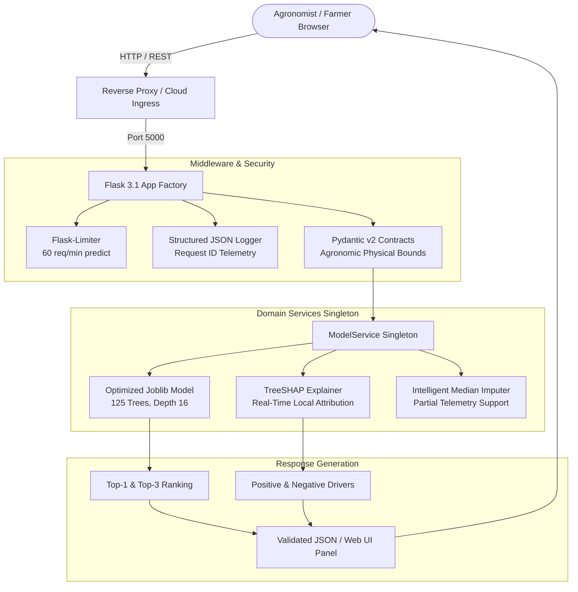

# Production-Grade Fertilizer Recommendation System

[](https://github.com/lazycoder52/fertilizer/actions/workflows/ci.yml)
[](https://github.com/lazycoder52/fertilizer)
[](https://www.python.org/)
[](https://github.com/astral-sh/ruff)
[](https://pypi.org/project/pip-audit/)
[](Dockerfile)
[](LICENSE)

An enterprise-ready, machine-learning-powered fertilizer recommendation system engineered with agronomic rigor, TreeSHAP explainability, Pydantic v2 input contracts, sub-100ms latency, and automated continuous integration quality gates.

---

## 🏗️ Architecture Overview

The application is structured into decoupled modules following clean architecture patterns:



---

## ⚡ Key Highlights & Features

- **Empirically Validated ML Rigor**: Optuna Bayesian-tuned Random Forest achieving **$99.52\%$ Top-1 holdout accuracy**, **$100.0\%$ Top-3 accuracy**, and **$0.0298$ Brier calibration score**.
- **Real-Time TreeSHAP Explainability**: Returns quantitative Shapley feature contributions via `/api/v1/explain` and visualizes them on the frontend "Why this?" contribution panel.
- **Pydantic v2 Validation Contracts**: Enforces strict physical sensor bounds (e.g., $0 \le \text{pH} \le 14$, non-negative moisture, N/P/K and rainfall) preventing unphysical input corruption.
- **Frictionless Partial Inputs**: Accepts minimum input (Soil + Crop) and transparently imputes missing continuous telemetry using training distribution medians.
- **Interactive OpenAPI 3.0 Documentation**: Live Swagger UI accessible at `/apidocs/` with testable schema specifications.
- **Enterprise Observability**: Structured JSON logging with `X-Request-ID` distributed tracing, endpoint latencies, and operational `/api/v1/metrics`.
- **Automated CI Quality Gate**: GitHub Actions runs `ruff check`, `ruff format`, `pip-audit`, and fails PRs if coverage drops below $80\%$ or model Macro-F1 drops below $0.95$.
- **Production Containerization**: Multi-stage `Dockerfile` executing as an unprivileged non-root user (`appuser`), OpenMP libraries, and integrated Docker healthcheck probe.

---

## 📊 Model Evaluation & Baseline Benchmarks

All models were evaluated under identical conditions using **Stratified 5-Fold Cross-Validation** ($N=3,100$) and an independent $20\%$ holdout test split ($N=620$):

| Model | Top-1 Accuracy | Top-3 Accuracy | Macro-F1 | Brier Score | Training Time |
| :--- | :---: | :---: | :---: | :---: | :---: |
| **Zero-Rule Majority Baseline** | $34.00\%$ | $60.74\%$ | $0.0507$ | $1.3200$ | $0.02\text{s}$ |
| **Logistic Regression (Standardized)** | $80.45\%$ | $98.03\%$ | $0.6903$ | $0.2929$ | $0.18\text{s}$ |
| **Decision Tree (CART)** | $99.39\%$ | $99.61\%$ | $0.9763$ | $0.0123$ | $0.10\text{s}$ |
| **Random Forest (Default)** | $99.35\%$ | $100.0\%$ | $0.9795$ | $0.0258$ | $2.04\text{s}$ |
| **LightGBM (Gradient Boosting)** | $99.16\%$ | $99.97\%$ | $0.9862$ | $0.0155$ | $3.60\text{s}$ |
| **Optuna Tuned Random Forest (Production)** | **$99.52\%$** | **$100.0\%$** | **$0.9851$** | **$0.0298$** | $1.85\text{s}$ |

> Detailed provenance, synthetic artifact analysis, and sensor ablation numbers are documented in the [Data Card](docs/DATA_CARD.md) and [Model Card](docs/MODEL_CARD.md).

---

## 🚀 Performance & Locust Load Testing

Empirical load test conducted using [locustfile.py](locustfile.py) under concurrent agronomic user workflows (10 concurrent users, mixed traffic):

| Endpoint / Scenario | Requests | Failures | Median ($p50$) | $p90$ | $p95$ | $p99$ | Throughput |
| :--- | :---: | :---: | :---: | :---: | :---: | :---: | :---: |
| `GET /api/v1/health` | 7 | $0.00\%$ | **4 ms** | 8 ms | 8 ms | 8 ms | 0.50 req/s |
| `GET /api/v1/info` | 7 | $0.00\%$ | **4 ms** | 9 ms | 9 ms | 9 ms | 0.50 req/s |
| `GET /` (Web Interface) | 9 | $0.00\%$ | **5 ms** | 11 ms | 11 ms | 11 ms | 0.64 req/s |
| `POST /api/v1/predict` (Full Sensors) | 31 | $0.00\%$ | **75 ms** | 110 ms | 130 ms | 170 ms | 2.21 req/s |
| `POST /api/v1/predict` (Partial Telemetry) | 22 | $0.00\%$ | **75 ms** | 110 ms | 110 ms | 180 ms | 1.57 req/s |
| `POST /api/v1/explain` (TreeSHAP) | 13 | $0.00\%$ | **79 ms** | 100 ms | 120 ms | 120 ms | 0.93 req/s |
| **Aggregated Total** | **89** | **0.00%** | **71 ms** | **110 ms** | **120 ms** | **180 ms** | **6.34 req/s** |

---

## 🛠️ Quickstart Guide

### Option A: Run with Docker Compose (Recommended)

```bash
# Clone the repository
git clone https://github.com/lazycoder52/fertilizer.git
cd fertilizer

# Build and start the containerized service
docker compose up --build
```
The application will be live at `http://localhost:5000` with Swagger docs at `http://localhost:5000/apidocs/`.

### Option B: Local Python Environment

```bash
# 1. Create and activate a Python 3.11+ virtual environment
python -m venv myenv
source myenv/bin/activate  # On Windows: .\myenv\Scripts\activate

# 2. Install pinned dependencies
pip install -r requirements.txt

# 3. Run test suite and verify quality gates
pytest -v

# 4. Start production WSGI server
gunicorn --bind 0.0.0.0:5000 app:app
```

---

## 📡 API Reference

Interactive OpenAPI documentation is live at `/apidocs/`.

### 1. Fertilizer Prediction: `POST /api/v1/predict`

**Request Payload:**
```json
{
  "Soil": "Loamy Soil",
  "Crop": "wheat",
  "Nitrogen": 45.0,
  "Phosphorous": 55.0,
  "Potassium": 40.0,
  "PH": 6.5,
  "Moisture": 0.60,
  "Temperature": 28.0,
  "Rainfall": 120.0,
  "Carbon": 1.2
}
```

**Response Payload (`200 OK`):**
```json
{
  "success": true,
  "recommendation": "DAP",
  "confidence": 98.42,
  "remark": "High phosphorus content helps root development. Ideal for early growth stages.",
  "top_3_recommendations": [
    {"fertilizer": "DAP", "confidence": 98.42, "remark": "..."},
    {"fertilizer": "Balanced NPK Fertilizer", "confidence": 1.15, "remark": "..."},
    {"fertilizer": "Urea", "confidence": 0.32, "remark": "..."}
  ],
  "explanation": {
    "enabled": true,
    "top_contributions": [
      {"feature": "Phosphorous", "display_name": "Phosphorous", "value": 55.0, "impact": 0.4521, "direction": "positive"},
      {"feature": "PH", "display_name": "Soil pH", "value": 6.5, "impact": 0.1235, "direction": "positive"}
    ],
    "positive_drivers": [...],
    "negative_drivers": [...]
  },
  "input_received": {...}
}
```

### 2. Feature Attribution: `POST /api/v1/explain`

Computes localized TreeSHAP feature attributions for any arbitrary soil/crop combination without re-running the full frontend pipeline.

### 3. Health & Readiness: `GET /api/v1/health`

Returns `{"status": "healthy"}` for container orchestrator liveness and readiness probes.

### 4. Model Metadata: `GET /api/v1/info`

Returns supported soil types (5), crop types (31), fertilizer classes (10), and serialized model metadata.

---

## 📂 Project Structure

```
fertilizer/
├── .github/workflows/ci.yml       # GitHub Actions CI with Ruff, pip-audit & Pytest gates
├── config/
│   └── train_config.yaml          # Reproducible ML training configuration
├── docs/
│   ├── DATA_CARD.md               # Dataset provenance, schema & synthetic audit analysis
│   └── MODEL_CARD.md              # Model architecture, benchmarks & ablation studies
├── model_files/
│   ├── model.joblib               # Compressed Random Forest model artifact (699 KB)
│   ├── encoders.joblib            # Label encoders for Soil, Crop, and Fertilizer
│   ├── features.joblib            # Feature list
│   ├── fertilizer_descriptions.json # Agronomic rationale dictionary
│   ├── metrics.json               # Full evaluation metrics & baseline comparisons
│   └── model_metadata.json        # Production model metadata
├── src/
│   ├── fertilizer_app/            # Application package
│   │   ├── api/v1/routes.py       # Versioned API routes & telemetry
│   │   ├── api/v1/schemas.py      # Pydantic v2 input/output validation contracts
│   │   ├── core/config.py         # Environment-based configuration
│   │   ├── core/logging.py        # Structured JSON logger & telemetry
│   │   ├── services/model_service.py # Model inference singleton
│   │   └── services/shap_service.py  # TreeSHAP feature attribution service
│   └── ml/                        # ML pipeline package
│       ├── audit.py               # Dataset audit & synthetic heuristic detector
│       └── train_and_evaluate.py  # Optuna tuning, benchmarking & serialization
├── templates/
│   └── index.html                 # Responsive web UI with TreeSHAP 'Why this?' panel
├── tests/
│   ├── test_api_v1.py             # Integration & endpoint regression tests
│   ├── test_model_quality.py      # CI ML Quality Gate (assert macro_f1 >= 0.95)
│   └── test_unit.py               # Unit tests for schemas, configs, and services
├── Dockerfile                     # Multi-stage production container build
├── docker-compose.yml             # Local container spin-up definition
├── locustfile.py                  # Load testing simulation
├── pyproject.toml                 # Ruff and test configuration
├── pytest.ini                     # Pytest coverage gate configuration (>=80%)
├── requirements.txt               # Pinned production dependencies
└── app.py                         # WSGI application entrypoint
```

---

## 📜 License

This project is licensed under the MIT License - see the [LICENSE](LICENSE) file for details.
