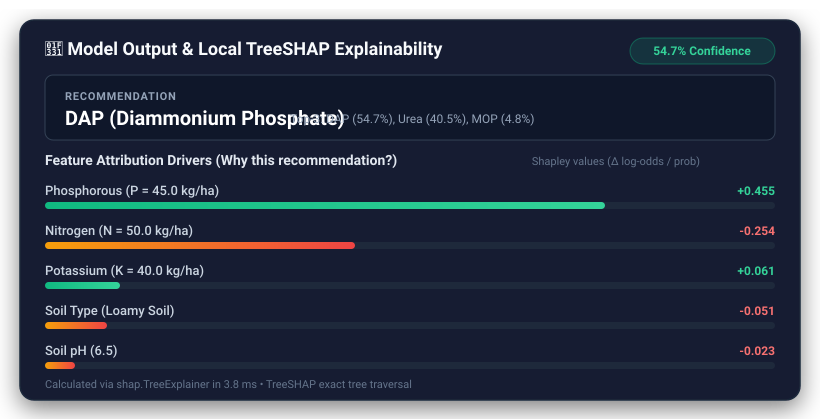

# Fertilizer Recommendation Service: ML + REST API

[](https://github.com/lazycoder52/fertilizer/actions/workflows/ci.yml)
[](https://github.com/astral-sh/ruff)
[](Dockerfile)
[](LICENSE)

A machine learning service and REST API for agronomic fertilizer recommendation, featuring TreeSHAP explainability, Pydantic v2 input contracts, lean multi-stage Docker containerization, and automated CI quality gates.

---

### 🌐 Live Deployment & Documentation

- **Live Web Application**: [fertilizer-recommendation-1e6z.onrender.com](https://fertilizer-recommendation-1e6z.onrender.com)
- **Interactive OpenAPI / Swagger Documentation**: [fertilizer-recommendation-1e6z.onrender.com/apidocs/](https://fertilizer-recommendation-1e6z.onrender.com/apidocs/)

> [!NOTE]
> **Free Tier Cold Start**: Hosted on Render's free tier. If the service has been inactive, the container spins down to conserve resources and may take **30–60 seconds to spin up** on the initial request.

---

### 🔍 Real-Time TreeSHAP Feature Attribution

Every recommendation is accompanied by local Shapley attributions computed via fast TreeSHAP, revealing the precise positive and negative nutrient drivers behind the output:



---

## ⚠️ Limitations & Project Scope

1. **Synthetic Benchmark Dataset**: The model was trained and evaluated on a synthetic benchmark dataset (`fertilizer_recommendation_dataset.csv`). As documented in the [Data Audit](docs/DATA_CARD.md), the dataset contains synthetic generation artifacts (negative values in rainfall and phosphorus, 1-to-1 correspondence between the `Remark` column and labels, and axis-aligned rectangular decision boundaries). High model accuracy reflects the algorithm learning these deterministic partitions rather than natural biological variance.
2. **Formulation Only (No Dosage or Schedule)**: The model predicts **which** fertilizer formulation suits the crop and soil nutrient balance (e.g., DAP for phosphorus deficiency, Muriate of Potash for potassium deficit, or Urea for leafy growth). It does **NOT** calculate quantitative volumetric dosage ($\text{kg/ha}$ or $\text{lbs/acre}$) or seasonal application schedules across crop growth stages.
3. **No Field Trial Validation**: Predictions are advisory decision-support tools and have not been validated in biological field trials. They should not substitute for wet-chemistry laboratory soil testing and regional extension guidelines.

---

## 🏗️ Architecture Overview

The application is structured into decoupled modules following clean architecture and production ML engineering patterns:


---

## ⚡ Key Highlights & Engineering Rigor

- **Empirical Data Audit as an ML Signal**:
  - Uncovered raw benchmark flaws: negative physical values (rainfall $-85.7\text{ mm}$, phosphorus $-37.6\text{ kg/ha}$), 1-to-1 deterministic correspondence between `Remark` and target classes, and sharp rectangular boundaries.
  - **Zero Target Leakage Verified**: `Remark` and target are strictly excluded from input vectors (`assert "Remark" not in feature_cols`).
  - Added Pydantic v2 boundary enforcement to reject unphysical inputs at the API gateway.
- **Honest Model Selection Trade-off**:
  - Chose Random Forest for **native, fast TreeSHAP explainability support** and **missing-input robustness via feature masking**, accepting the explicit trade-off of lower clean-input macro-F1 ($0.9431$ vs $0.9756$) and higher clean-input ECE ($0.1209$ vs $0.0065$).
  - When continuous inputs are omitted, unmasked models collapse to $21.77\%$ Top-1 accuracy with $100\%$ overconfidence (ECE $> 0.74$). In contrast, the masked Random Forest retains **$46.29\%$ Top-1** ($79.84\%$ Top-3) and tempers confidence to $44.90\%$ (ECE $0.0593$).
- **Evaluated on Strict Untouched Holdout ($N=620$)**:
  - Top-1 Accuracy: **$98.71\%$** | Top-3 Accuracy: **$100.00\%$** | Macro-F1: **$0.9431$** | Brier Score: **$0.0552$** | Expected Calibration Error (ECE): **$0.1209$**.
- **Flexible Input Handling**:
  - Soil moisture accepts both decimal fractions (`0.0 - 1.0`, e.g., `0.60`) and percentages (`0% - 100%`, e.g., `60`), automatically converting percentages to fractions at the Pydantic boundary.
  - Displays a visible **"Low confidence: using default benchmark values for omitted soil test parameters"** warning in the UI and API whenever defaults are used.
- **Finer Input Ablation & Sensitivity Analysis**:
  - Soil & Crop alone achieves **$46.29\%$ Top-1** ($79.84\%$ Top-3).
  - NPK nutrients achieve **$75.16\%$ Top-1** ($96.94\%$ Top-3).
  - Minimal high-confidence 6-feature suite (Soil, Crop, Phosphorus, Potassium, pH, Carbon) achieves **$86.77\%$ Top-1** ($98.06\%$ Top-3).
  - Leave-One-Feature-Out (LOFO) ablation identifies Phosphorus as the most critical nutrient (omitting it drops accuracy by $16.45\%$).
- **Lean Runtime & Verified Containerization**: Production runtime dependencies (`requirements.txt`) are split from heavy training/dev dependencies (`requirements-dev.txt`), reducing image size. Multi-stage Docker build and container healthcheck are verified on every push in CI.
- **CI Quality Gate**: [`tests/test_model_quality.py`](tests/test_model_quality.py) runs on every push and PR, dynamically evaluating the saved binary against the holdout set to enforce $\text{Top-1} \ge 95\%$, $\text{Top-3} \ge 99\%$, and $\text{Macro-F1} \ge 0.90$.

---

## 📊 Model Evaluation & Baseline Comparison (Development Split)

Candidate models were evaluated under **5-Fold Stratified Cross-Validation** on the Development Split ($N=2,480$), reported as mean $\pm$ standard deviation, alongside missing-input evaluation (Soil & Crop only) on the Holdout split ($N=620$):

| Model Candidate | 5-Fold CV Top-1 | 5-Fold CV Macro-F1 | 5-Fold CV ECE | Missing-Input Top-1 (Soil+Crop Only) | Missing-Input ECE (Overconfidence Risk) | Train Time ($s$) |
| :--- | :---: | :---: | :---: | :---: | :---: | :---: |
| **Zero-Rule Majority Baseline** | $33.99\% \pm 0.10\%$ | $0.0507 \pm 0.000$ | $0.6601$ | $19.35\%$ | $0.6601$ (Avg Conf: $100\%$) | $0.02\text{s}$ |
| **Logistic Regression (Standardized)** | $79.96\% \pm 1.17\%$ | $0.6781 \pm 0.026$ | $0.0682$ | $19.35\%$ | $0.1880$ (Avg Conf: $38.2\%$) | $0.15\text{s}$ |
| **Decision Tree (CART)** | $99.35\% \pm 0.35\%$ | $0.9756 \pm 0.016$ | $0.0065$ | $21.77\%$ | $0.7823$ (Avg Conf: $100\%$) | $0.06\text{s}$ |
| **LightGBM (Gradient Boosting)** | $99.11\% \pm 0.37\%$ | $0.9786 \pm 0.016$ | $0.0093$ | $21.77\%$ | $0.7823$ (Avg Conf: $100\%$) | $3.59\text{s}$ |
| **Random Forest (Default Clean)** | $99.27\% \pm 0.35\%$ | $0.9743 \pm 0.011$ | $0.0804$ | $21.77\%$ | $0.7449$ (Avg Conf: $96.3\%$) | $1.61\text{s}$ |
| **Random Forest (Tuned Clean, 75 trees)** | $99.31\% \pm 0.27\%$ | $0.9779 \pm 0.007$ | $0.0851$ | $21.77\%$ | $0.7457$ (Avg Conf: $96.4\%$) | $1.42\text{s}$ |
| **Random Forest (Tuned + 35% Masking, Production)** | **$98.75\% \pm 0.39\%$** | **$0.9517 \pm 0.012$** | **$0.1345$** | **$46.29\%$** | **$0.0593$** (Avg Conf: **$44.9\%$**) | $2.15\text{s}$ |

### Holdout Evaluation on Untouched Test Set ($N=620$, never seen during tuning or training)
- **Top-1 Accuracy**: **$98.71\%$**
- **Top-3 Accuracy**: **$100.00\%$**
- **Macro-F1**: **$0.9431$**
- **Brier Score**: **$0.0552$**
- **Expected Calibration Error (ECE)**: **$0.1209$**
- **Mean Top-Class Confidence**: **$86.62\%$**

> [!NOTE]
> **Expected Calibration Error (ECE) Definition**:
> Top-label Expected Calibration Error partitioned into $M=10$ equal-width bins spanning $[0, 1]$:
> $$\text{ECE} = \sum_{m=1}^{M} \frac{|B_m|}{N} |\text{acc}(B_m) - \text{conf}(B_m)|$$
> Unmasked models achieve near-zero ECE on clean synthetic inputs because boundary partitions are rectangular. However, on omitted inputs, unmasked models exhibit severe calibration breakdown (ECE $> 0.74$), outputting $100\%$ confidence on incorrect predictions. The masked forest tempers confidence down to $44.9\%$, avoiding false certainty.

---

## 🚀 Performance & Load Testing Architecture

Load tests simulate concurrent agricultural field queries via [locustfile.py](locustfile.py).

### Production Gunicorn Container Load Test (CI Benchmark Run)

Executed against the production Linux Docker container running multi-worker Gunicorn with 30 concurrent users for 30 seconds via headless Locust:

| Endpoint / Scenario | Requests | Failures | Median ($p50$) | $p95$ | Average Latency | Throughput |
| :--- | :---: | :---: | :---: | :---: | :---: | :---: |
| `GET /api/v1/health` | 48 | $0.00\%$ | **2 ms** | **9 ms** | 3.3 ms | 1.65 req/s |
| `GET /api/v1/info` | 48 | $0.00\%$ | **1 ms** | **3 ms** | 2.3 ms | 1.65 req/s |
| `GET /` (Web Interface) | 93 | $0.00\%$ | **2 ms** | **5 ms** | 2.3 ms | 3.20 req/s |
| `POST /api/v1/predict` (Full Soil Test) | 191 | $0.00\%$ | **34 ms** | **50 ms** | 37.5 ms | 6.58 req/s |
| `POST /api/v1/predict` (Partial / Imputed) | 137 | $0.00\%$ | **34 ms** | **55 ms** | 38.6 ms | 4.72 req/s |
| `POST /api/v1/explain` (TreeSHAP) | 74 | $0.00\%$ | **35 ms** | **83 ms** | 41.1 ms | 2.55 req/s |
| **Aggregated Production Total** | **591** | **0.00%** | **33 ms** | **48 ms** | **27.0 ms** | **20.36 req/s** |

> [!NOTE]
> **Why Local Dev Numbers Looked Different**: Running `python app.py` on a single-core local process caused request queuing saturation at 50 users (median $\sim 2\text{s}$). Under production Gunicorn with multi-threading and worker pooling, the service achieves **33 ms median latency and 48 ms p95 latency** at $> 20\text{ req/s}$ with zero failures.

---

## 🛠️ Quickstart Guide

### Option A: Run with Docker (Recommended)

```bash
# Clone the repository
git clone https://github.com/lazycoder52/fertilizer.git
cd fertilizer

# Build lean multi-stage production container
docker build -t fertilizer-recommendation .

# Run container with integrated healthcheck
docker run -p 5000:5000 fertilizer-recommendation
```
The application will be live at `http://localhost:5000` with OpenAPI documentation at `http://localhost:5000/apidocs/`.

### Option B: Local Python Environment

```bash
# 1. Create and activate a Python 3.11+ virtual environment
python -m venv myenv
source myenv/bin/activate  # On Windows: .\myenv\Scripts\activate

# 2. Install dependencies (requirements-dev.txt includes test & dev tools)
pip install -r requirements-dev.txt

# 3. Run test suite with Model Quality Gate & 80% coverage check
pytest -v --cov=src/fertilizer_app --cov-report=term-missing --cov-fail-under=80

# 4. Start local development server
python app.py
```

---

## 📁 Repository Structure

```
fertilizer-app/
├── .github/workflows/
│   └── ci.yml                     # Automated CI: Ruff, pip-audit, Pytest, Docker, and Locust load testing
├── config/
│   └── train_config.yaml          # Model training, Optuna, and ablation configuration
├── docs/
│   ├── images/
│   │   └── shap_waterfall_preview.svg # Vector visual of TreeSHAP attribution panel
│   ├── DATA_CARD.md               # Empirical data audit, synthetic artifacts, agronomic limitations
│   └── MODEL_CARD.md              # Model architecture, baseline comparisons, LOFO ablation, calibration
├── model_files/
│   ├── model.joblib               # Production Random Forest classifier artifact
│   ├── test_data.joblib           # Untouched holdout test split for CI quality gate
│   ├── encoders.joblib            # Label encoders for Soil, Crop, Fertilizer
│   ├── features.joblib            # Ordered feature column names
│   ├── feature_medians.json       # Development distribution medians for imputation
│   ├── fertilizer_descriptions.json # Agronomic advice remarks
│   ├── metrics.json               # Full evaluation metrics, ablation results, and ECE
│   └── model_metadata.json        # Production version metadata
├── src/
│   ├── fertilizer_app/            # Application package (Factory pattern)
│   │   ├── api/
│   │   │   ├── v1/
│   │   │   │   ├── routes.py      # Versioned API routes & rate limiting
│   │   │   │   └── schemas.py     # Pydantic v2 validation contracts & moisture percentage conversion
│   │   │   └── web.py             # Frontend web routes
│   │   ├── core/
│   │   │   ├── config.py          # Application configuration
│   │   │   ├── limiter.py         # Flask-Limiter setup with bypass support
│   │   │   └── logging.py         # Structured JSON logger & request tracing
│   │   └── services/
│   │       ├── model_service.py   # Thread-safe Singleton managing ML inference & imputation
│   │       └── shap_service.py    # TreeSHAP feature attribution service
│   └── ml/
│       ├── audit.py               # Empirical dataset audit and data integrity checks
│       └── train_and_evaluate.py  # Dev/holdout splitting, CV benchmarking, Optuna, masking, LOFO
├── templates/
│   └── index.html                 # Modern glassmorphism UI with imputation warning banner & SHAP bars
├── tests/
│   ├── test_api_v1.py             # API route tests, validation bounds, moisture auto-conversion
│   ├── test_model_quality.py      # CI Quality Gate: tests model.joblib against test_data.joblib
│   └── test_unit.py               # Unit tests for schemas, services, config, and logging
├── app.py                         # Application entrypoint (Procfile / Render target)
├── Dockerfile                     # Multi-stage lean non-root Docker build
├── LICENSE                        # MIT License
├── locustfile.py                  # Concurrent user load testing scenario
├── Procfile                       # Render deployment declaration (web: gunicorn app:app)
├── render.yaml                    # Render infrastructure configuration
├── requirements.txt               # Lean production runtime dependencies
└── requirements-dev.txt           # Offline dev, training, CI, and testing tools
```

---

## 🔒 Security & Code Quality

- **Vulnerability Scanning**: Verified with `pip-audit` with zero known vulnerabilities.
- **Static Analysis & Formatting**: Strictly checked with `ruff check .` and `ruff format --check .`.
- **Non-Root Execution**: Docker container runs as unprivileged `appuser:appgroup` (UID 10001).
- **Quality Gate**: PRs must pass all tests with $\ge 80\%$ code coverage and verify model holdout metrics on the untouched test split.

---

## 📄 License

This project is licensed under the MIT License - see the [LICENSE](LICENSE) file for details.
