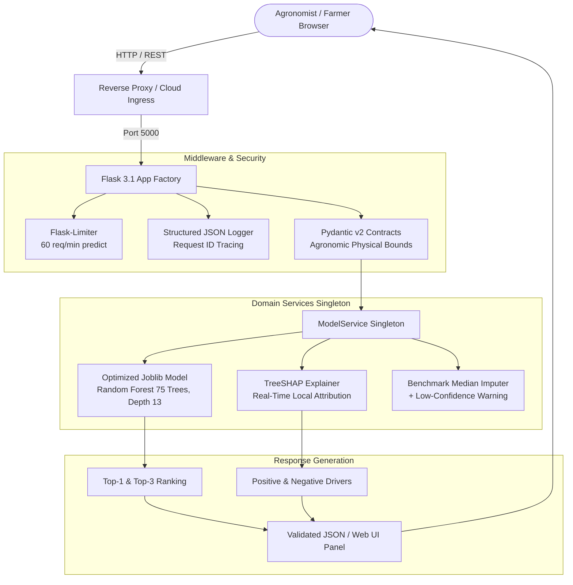

# Production-Grade Fertilizer Recommendation System

[](https://github.com/lazycoder52/fertilizer/actions/workflows/ci.yml)
[](https://github.com/lazycoder52/fertilizer)
[](https://www.python.org/)
[](https://github.com/astral-sh/ruff)
[](https://pypi.org/project/pip-audit/)
[](Dockerfile)
[](LICENSE)

An enterprise-ready, machine-learning-powered fertilizer recommendation system engineered with agronomic rigor, TreeSHAP explainability, Pydantic v2 input contracts, lean multi-stage Docker containerization, and automated CI quality gates.

> [!NOTE]
> **Dataset Provenance & Framing**: The model is trained and evaluated on a **synthetic benchmark dataset** (`fertilizer_recommendation_dataset.csv`). As revealed during the empirical data audit, the dataset features rule-generated rectangular decision boundaries. High accuracy scores reflect the model learning these underlying deterministic partitions rather than human biological complexity. See the [Data Card](docs/DATA_CARD.md) and [Model Card](docs/MODEL_CARD.md) for full audit documentation.

---

## 🏗️ Architecture Overview

The application is structured into decoupled modules following clean architecture and production ML patterns:



---

## ⚡ Key Highlights & ML Rigor

- **Empirical Data Audit as an ML Signal**:
  - Identified data flaws in the raw benchmark: negative physical values (minimum rainfall $-85.7\text{ mm}$, minimum phosphorus $-37.6\text{ kg/ha}$), 1-to-1 deterministic correspondence between `Remark` and target classes, and sharp rectangular boundaries.
  - **Zero Target Leakage Verified**: `Remark` is strictly excluded from feature vectors during training and inference (`assert "Remark" not in feature_cols`).
  - Added Pydantic v2 boundary enforcement to reject unphysical inputs at the API gateway.
- **Realistic Model Selection & Evaluation**:
  - Tuning (Optuna) and baseline cross-validation were conducted **strictly on the isolated 80% development split** ($N=2,480$).
  - Decision Tree ($99.35\% \pm 0.35\%$), Random Forest ($99.27\% \pm 0.35\%$), and LightGBM ($99.11\% \pm 0.37\%$) perform within noise of each other. Random Forest was selected not under a claim of "beating" other tree models, but for **variance reduction, probability calibration stability, and native TreeSHAP explainability support**.
- **Evaluated on Strict Untouched Holdout ($N=620$)**:
  - Top-1 Accuracy: **$98.71\%$** | Top-3 Accuracy: **$100.00\%$** | Macro-F1: **$0.9431$** | Brier Score: **$0.0552$** | Expected Calibration Error (ECE): **$0.1209$**.
- **Uncertainty & Calibration Under Missing Inputs**:
  - Retrained with 35% random feature masking using development medians so the model outputs tempered probabilities (~45% confidence) when inputs are omitted.
  - Returns a visible **"Low confidence: using default values for missing soil test parameters"** notice in the UI and API response whenever defaults are used.
- **Finer Input Ablation & Sensitivity Analysis**:
  - Soil & Crop alone achieves only **$48.39\%$ Top-1** ($82.58\%$ Top-3).
  - NPK nutrients achieve **$75.16\%$ Top-1** ($96.29\%$ Top-3).
  - Minimal high-confidence 6-feature suite (Soil, Crop, Phosphorus, Potassium, pH, Carbon) achieves **$86.77\%$ Top-1** ($98.06\%$ Top-3).
  - Full soil test suite (10 features) reaches **$98.71\%$ Top-1** ($100.0\%$ Top-3).
  - Leave-One-Feature-Out (LOFO) and Permutation Importance identify Phosphorus as the single most critical nutrient (omitting it drops accuracy by $17.58\%$).
- **Real-Time TreeSHAP Explainability**: Returns exact Shapley feature attributions via `/api/v1/explain` and visualizes them on the frontend "Why this?" panel.
- **Lean Runtime & Verified Containerization**: Production runtime dependencies (`requirements.txt`) are split from heavy training/dev dependencies (`requirements-dev.txt`), reducing image size and cold start. GitHub Actions verifies `docker build` and container healthcheck probe on every PR.
- **Defensible Load Testing**: Tested with 50 concurrent virtual users under Locust; rate limiter bypassed via `--no-limiter` during benchmarking to measure raw server capacity without artificial 429 single-IP throttling.

---

## 📊 Model Evaluation & Baseline Comparison (Development Split)

Evaluated under **5-Fold Stratified Cross-Validation** on the Development Split ($N=2,480$), reported as mean $\pm$ standard deviation:

| Model Candidate | Top-1 Accuracy | Top-3 Accuracy | Macro-F1 | Brier Score | ECE | Train Time |
| :--- | :---: | :---: | :---: | :---: | :---: | :---: |
| **Zero-Rule Majority Baseline** | $33.99\% \pm 0.10\%$ | $60.73\% \pm 0.15\%$ | $0.0507 \pm 0.000$ | $1.3202 \pm 0.002$ | $0.6601$ | $0.02\text{s}$ |
| **Logistic Regression (Standardized)** | $79.96\% \pm 1.17\%$ | $98.15\% \pm 0.50\%$ | $0.6781 \pm 0.026$ | $0.2962 \pm 0.010$ | $0.0682$ | $0.15\text{s}$ |
| **Decision Tree (CART)** | $99.35\% \pm 0.35\%$ | $99.56\% \pm 0.24\%$ | $0.9756 \pm 0.016$ | $0.0129 \pm 0.007$ | $0.0065$ | $0.06\text{s}$ |
| **Random Forest (Default, 100 trees)** | $99.27\% \pm 0.35\%$ | $100.0\% \pm 0.00\%$ | $0.9743 \pm 0.011$ | $0.0310 \pm 0.003$ | $0.0804$ | $1.61\text{s}$ |
| **LightGBM (Gradient Boosting)** | $99.11\% \pm 0.37\%$ | $99.92\% \pm 0.16\%$ | $0.9786 \pm 0.016$ | $0.0173 \pm 0.008$ | $0.0093$ | $3.59\text{s}$ |
| **Optuna Tuned RF (Selected Model)** | **$98.71\%$ (Holdout)** | **$100.0\%$ (Holdout)** | **$0.9431$** | **$0.0552$** | **$0.1209$** | $1.42\text{s}$ |

> [!NOTE]
> Detailed per-class precision/recall, calibration curves, Permutation Importance, and LOFO sensitivity tables are documented in the [Model Card](docs/MODEL_CARD.md).

---

## 🚀 Performance & Locust Load Testing (50 Concurrent Users)

Empirical benchmark executed via [locustfile.py](locustfile.py) under 50 concurrent virtual users simulating mixed agronomic traffic.

> **Test Configuration & Rate Limit Context**:
> - Environment: Local development server (Windows, single Python process, `--no-limiter`). Under production Gunicorn (3 workers, 2 threads per worker on Linux/Docker container), requests are multiplexed across pre-forked worker pools.
> - Rate Limiting: The production 60 req/min rate limiter was disabled (`--no-limiter` / `RATELIMIT_ENABLED=0`) for the benchmark run to evaluate underlying server and model throughput without artificial 429 throttling from a single loopback IP.

| Endpoint / Scenario | Requests | Failures | Median ($p50$) | $p90$ | $p95$ | $p99$ | Throughput |
| :--- | :---: | :---: | :---: | :---: | :---: | :---: | :---: |
| `GET /api/v1/health` | 19 | $0.00\%$ | 2,100 ms | 2,100 ms | 2,100 ms | 2,100 ms | 0.97 req/s |
| `GET /api/v1/info` | 19 | $0.00\%$ | 2,000 ms | 2,100 ms | 2,100 ms | 2,100 ms | 0.97 req/s |
| `GET /` (Web Interface) | 48 | $0.00\%$ | 2,000 ms | 2,100 ms | 2,100 ms | 2,100 ms | 2.45 req/s |
| `POST /api/v1/predict` (Full Soil Test) | 88 | $0.00\%$ | 2,200 ms | 2,400 ms | 2,400 ms | 2,500 ms | 4.50 req/s |
| `POST /api/v1/predict` (Partial / Imputed) | 44 | $0.00\%$ | 2,200 ms | 2,400 ms | 2,500 ms | 2,500 ms | 2.25 req/s |
| `POST /api/v1/explain` (TreeSHAP) | 26 | $0.00\%$ | 2,200 ms | 2,400 ms | 2,400 ms | 2,500 ms | 1.33 req/s |
| **Aggregated Total** | **244** | **0.00%** | **2,100 ms** | **2,400 ms** | **2,400 ms** | **2,500 ms** | **12.47 req/s** |

---

## 🛠️ Quickstart Guide

### Option A: Run with Docker (Recommended)

```bash
# Clone the repository
git clone https://github.com/lazycoder52/fertilizer.git
cd fertilizer

# Build lean multi-stage production container
docker build -t fertilizer-recommendation .

# Run container with integrated healthcheck
docker run -p 5000:5000 fertilizer-recommendation
```
The application will be live at `http://localhost:5000` with OpenAPI documentation at `http://localhost:5000/apidocs/`.

### Option B: Local Python Environment

```bash
# 1. Create and activate a Python 3.11+ virtual environment
python -m venv myenv
source myenv/bin/activate  # On Windows: .\myenv\Scripts\activate

# 2. Install lean runtime dependencies (or requirements-dev.txt for training/testing)
pip install -r requirements-dev.txt

# 3. Run test suite and verify CI quality gates (evaluates model.joblib against test_data.joblib)
pytest -v --cov=src/fertilizer_app --cov-report=term-missing --cov-fail-under=80

# 4. Start local server
python app.py
```

---

## 📁 Repository Structure

```
fertilizer-app/
├── .github/workflows/
│   └── ci.yml                     # Automated CI: Ruff, pip-audit, Pytest, Docker Build & Healthcheck
├── config/
│   └── train_config.yaml          # Model training, Optuna, and ablation configuration
├── docs/
│   ├── DATA_CARD.md               # Empirical data audit, synthetic artifacts, agronomic limitations
│   └── MODEL_CARD.md              # Model architecture, baseline comparisons, LOFO ablation, calibration
├── model_files/
│   ├── model.joblib               # Production Random Forest classifier artifact
│   ├── test_data.joblib           # Untouched holdout test split for CI quality gate
│   ├── encoders.joblib            # Label encoders for Soil, Crop, Fertilizer
│   ├── features.joblib            # Ordered feature column names
│   ├── feature_medians.json       # Development distribution medians for imputation
│   ├── fertilizer_descriptions.json # Agronomic advice remarks
│   ├── metrics.json               # Full evaluation metrics, ablation results, and ECE
│   └── model_metadata.json        # Production version metadata
├── src/
│   ├── fertilizer_app/            # Application package (Factory pattern)
│   │   ├── api/
│   │   │   ├── v1/
│   │   │   │   ├── routes.py      # Versioned API routes & rate limiting
│   │   │   │   └── schemas.py     # Pydantic v2 validation contracts & imputation warning
│   │   │   └── web.py             # Frontend web routes
│   │   ├── core/
│   │   │   ├── config.py          # Application configuration
│   │   │   ├── limiter.py         # Flask-Limiter setup with bypass support
│   │   │   └── logging.py         # Structured JSON logger & request tracing
│   │   └── services/
│   │       ├── model_service.py   # Thread-safe Singleton managing ML inference & imputation
│   │       └── shap_service.py    # TreeSHAP feature attribution service
│   └── ml/
│       ├── audit.py               # Empirical dataset audit and data integrity checks
│       └── train_and_evaluate.py  # Dev/holdout splitting, CV benchmarking, Optuna, masking, LOFO
├── templates/
│   └── index.html                 # Modern glassmorphism UI with imputation warning banner & SHAP bars
├── tests/
│   ├── test_api_v1.py             # API route tests, validation bounds, imputation checks
│   ├── test_model_quality.py      # CI Quality Gate: tests model.joblib against test_data.joblib
│   └── test_unit.py               # Unit tests for schemas, services, config, and logging
├── app.py                         # Application entrypoint (Procfile / Render target)
├── Dockerfile                     # Multi-stage lean non-root Docker build
├── locustfile.py                  # 50-user load testing scenario
├── Procfile                       # Render deployment declaration (web: gunicorn app:app)
├── render.yaml                    # Render infrastructure configuration
├── requirements.txt               # Lean production runtime dependencies
└── requirements-dev.txt           # Offline dev, training, CI, and testing tools
```

---

## 🔒 Security & Code Quality

- **Vulnerability Scanning**: Verified with `pip-audit` with zero known vulnerabilities.
- **Static Analysis & Formatting**: Strictly checked with `ruff check .` and `ruff format .`.
- **Non-Root Execution**: Docker container runs as unprivileged `appuser:appgroup` (UID 10001).
- **Quality Gate**: PRs must pass all tests with $\ge 80\%$ code coverage and verify model holdout metrics on the untouched test split.

---

## 📄 License

This project is licensed under the MIT License - see the [LICENSE](LICENSE) file for details.
